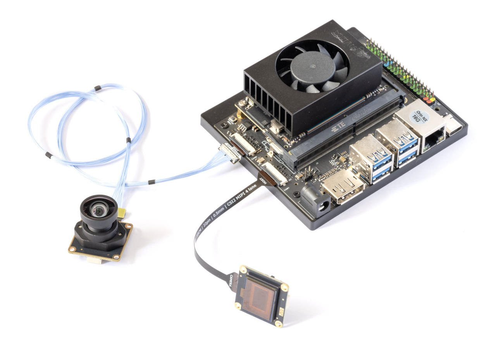
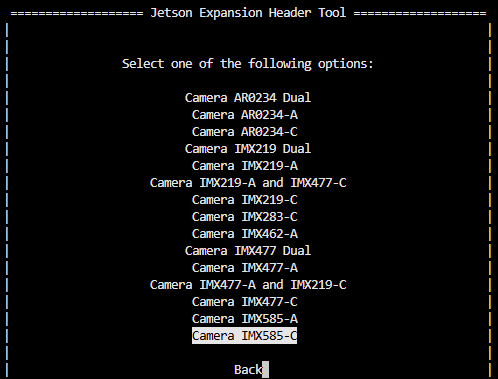

# IMX585 kernel driver for NVIDIA Jetson

[](https://github.com/Kurokesu/imx585-jetson-driver/actions/workflows/code-style.yml)
[](https://github.com/Kurokesu/imx585-jetson-driver/tags)


NVIDIA Jetson kernel driver for Sony IMX585, an 8.3 MP STARVIS 2 back-side illuminated CMOS sensor optimised for low-light and 4K applications.

- 2-lane and 4-lane MIPI CSI-2, single or dual camera
- 12-bit RAW output
- 3856×2180 (full resolution)
- 1928×1090 (2×2 binned)
- 25 fps on 4 lanes, 12.5 fps on 2 lanes

> [!NOTE]
> Bring-up release runs both modes at conservative 720 Mbps/lane, which caps frame rate at 25 fps on 4 lanes. Higher link rates, ClearHDR and mono support are planned.



*IMX585 camera modules are available at [kurokesu.com](https://www.kurokesu.com/item/585C-CSI)*

## Setup

Install required tools:

```bash
sudo apt install -y --no-install-recommends dkms
```

Clone this repository:

```bash
cd ~
git clone https://github.com/Kurokesu/imx585-jetson-driver.git
cd imx585-jetson-driver/
```

Run setup script:

```bash
sudo ./setup.sh
```

Setup script:

- Fetches NVIDIA device tree headers required for build
- Builds and installs kernel module via [DKMS](https://github.com/dell/dkms)
- Builds and copies device tree overlays (`.dtbo`) to `/boot`
- Installs udev rule keeping camera RTCPU awake

Use Jetson-IO to configure CSI connector:

```bash
sudo /opt/nvidia/jetson-io/jetson-io.py
```

Navigate through the menu:

1. Configure Jetson CSI Connector (named "22pin" on 6.2.2, "24pin" on 6.2.1)
2. Configure for compatible hardware
3. Select port configuration:

    - `Camera IMX585-A` - cam0 (2-lane)
    - `Camera IMX585-C` - cam1 (4-lane)
    - `Camera IMX585 Dual` - cam0 (2-lane) + cam1 (4-lane)

    

4. Save pin changes
5. Save and reboot to reconfigure pins

After reboot, verify sensor is detected:

```bash
sudo dmesg | grep imx585
```

Expected output:

```
nv_imx585: module verification failed: signature and/or required key missing - tainting kernel
imx585 9-001a: tegracam sensor driver:imx585_v2.0.6
tegra-camrtc-capture-vi tegra-capture-vi: subdev imx585 9-001a bound
```

*Signature warning is expected since DKMS modules are unsigned.*

## Image output

Sensor modes, selected with Argus `sensor-mode` or V4L2 `sensor_mode`:

| Mode                            | Port | Data rate / lane | Lanes | Bit depth | Width | Height | Max fps  |
| ------------------------------- | ---- | ---------------- | ----- | --------- | ----- | ------ | -------- |
| **3856×2180 (full resolution)** |      |                  |       |           |       |        |          |
| 0                               | cam0 | 720 Mbps         | 2     | 12        | 3856  | 2180   | 12.5 fps |
| 0                               | cam1 | 720 Mbps         | 4     | 12        | 3856  | 2180   | 25 fps   |
| **1928×1090 (2×2 binned)**      |      |                  |       |           |       |        |          |
| 1                               | cam0 | 720 Mbps         | 2     | 12        | 1928  | 1090   | 12.5 fps |
| 1                               | cam1 | 720 Mbps         | 4     | 12        | 1928  | 1090   | 25 fps   |

*Without `sensor-mode`, `nvarguscamerasrc` picks mode from requested resolution and frame rate.*

### GStreamer

Single:

```bash
gst-launch-1.0 -e nvarguscamerasrc sensor-id=0 ! \
   'video/x-raw(memory:NVMM),width=3856,height=2180,framerate=25/1' ! \
   queue ! nvvidconv ! queue ! nveglglessink
```

*On `cam0`, use `framerate=12/1`.*

Dual:

```bash
gst-launch-1.0 -e \
   nvarguscamerasrc sensor-id=0 ! \
      'video/x-raw(memory:NVMM),width=3856,height=2180,framerate=25/1' ! \
      queue ! nvvidconv ! queue ! nveglglessink \
   nvarguscamerasrc sensor-id=1 ! \
      'video/x-raw(memory:NVMM),width=3856,height=2180,framerate=12/1' ! \
      queue ! nvvidconv ! queue ! nveglglessink
```

### Raw V4L2

Install `v4l-utils`:

```bash
sudo apt install -y v4l-utils
```

> [!IMPORTANT]
> With dual overlay, NVIDIA maps cam1 to `/dev/video0` and cam0 to `/dev/video1`.

Stream raw 12-bit frame to file:

```bash
v4l2-ctl -d /dev/video0 \
   --set-ctrl bypass_mode=0,sensor_mode=0,override_enable=1 \
   --set-ctrl frame_rate=25000000,exposure=10000,gain=0 \
   --set-fmt-video=width=3856,height=2180,pixelformat=RG12 \
   --stream-mmap --stream-skip=10 --stream-count=1 \
   --stream-to imx585_2180p.raw --verbose
```

*`override_enable=1` applies frame rate, exposure and gain. Controls keep last written value across sessions, so set them explicitly. Frame rate is in fps × 1000000, exposure in µs and gain in dB × 10 (0 to 720, step 3).*

*`sensor_mode` selects sensor readout and must match format resolution.*

Stream binned frame:

```bash
v4l2-ctl -d /dev/video0 \
   --set-ctrl bypass_mode=0,sensor_mode=1,override_enable=1 \
   --set-ctrl frame_rate=25000000,exposure=10000,gain=0 \
   --set-fmt-video=width=1928,height=1090,pixelformat=RG12 \
   --stream-mmap --stream-skip=10 --stream-count=1 \
   --stream-to imx585_1090p.raw --verbose
```

*`bypass_mode=0` resets what Argus leaves behind. Without it raw capture after an Argus session gets no frames.*

## Test mode

IMX585 has a built-in test pattern generator for verifying data validity.

Enable test pattern:

```bash
# Horizontal color-bar test pattern (test_mode = 5)
echo 5 | sudo tee /sys/module/nv_imx585/parameters/test_mode
```

Turn test pattern off:

```bash
echo 0 | sudo tee /sys/module/nv_imx585/parameters/test_mode
```

| Test pattern code | Description |
| ----------------- | ----------- |
| 0 | Off (normal operation) |
| 1 | All 000h |
| 2 | All FFFh |
| 3 | All 555h |
| 4 | All AAAh |
| 5 | Horizontal color bars |
| 6 | Vertical color bars |

## RTCPU keep-awake

On JetPack 6 camera RTCPU suspends after 5 s idle and redoes NVCSI calibration on resume. When that fails, next Argus (`nvarguscamerasrc`) launch gets no frames until reboot:

```
SCF: Error InvalidState: Timeout!! Skipping requests on sensor GUID 0 ... (FusaCaptureViCsiHw.cpp, function waitCsiFrameStart())
```

`setup.sh` installs `udev/99-camera-rtcpu.rules` to keep RTCPU awake, as NVIDIA [suggests](https://forums.developer.nvidia.com/t/issue-about-nvcsi/299349). Manual alternative, lasts until reboot:

```bash
echo on | sudo tee /sys/devices/platform/bc00000.rtcpu/power/control
```

## Development builds

For manual builds without DKMS:

```bash
make              # build everything (dtbo + kernel module)
sudo make install # copy dtbo to /boot, rmmod + insmod
```

> [!NOTE]
> Module is loaded immediately via `insmod` but won't persist across reboots. Use `sudo ./setup.sh` for permanent installation via DKMS.

Individual targets:

```bash
make dtbo      # build only the device tree overlays
make module    # build only the kernel module
make clean     # remove build artifacts
```

Build artifacts are placed in `./build`.
